# Fireline

Fireline predicts which 375 m pixels of an active wildfire will be burning tomorrow, from the last five days of
satellite, weather and terrain data. It also tests whether self-supervised pretraining with a joint-embedding
predictive architecture (JEPA) helps when labelled fires are scarce.

<p align="center">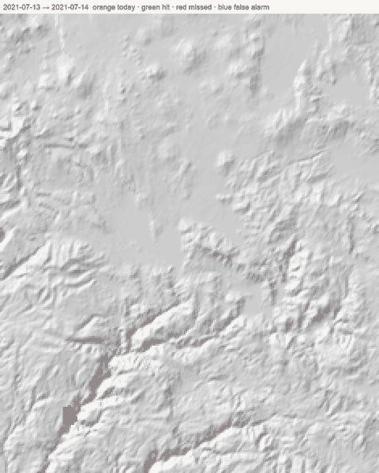</p>

**Next-day fire · test year 2021 · 3,337 fire-days, scored once**

| Method | AP | F1 at 0.5 | Precision | Recall |
| --- | ---: | ---: | ---: | ---: |
| Persistence (tomorrow = today) | 0.287 | 0.53 | 0.53 | 0.53 |
| Neighbourhood (share of fire in a 5 × 5 window) | 0.407 | 0.49 | 0.56 | 0.43 |
| **Fireline U-Net** | **0.567** | **0.59** | **0.60** | **0.58** |

Fire covers 0.3% of valid pixels, so a constant score gets AP 0.003. All choices were made on 2020; the 2021 test
year was evaluated once, at the end. The ranking of methods is the same on both years.

Three findings:

- **Skill is near the fire.** 80% of tomorrow's fire is already burning or within 750 m of today's, and the model
  reaches AP 0.77 and 0.41 there. Beyond 1.9 km it is below 0.1 ([Analysis](#analysis-where-tomorrows-fire-comes-from)).
- **JEPA pretraining did not help at this scale.** The best variant passed the pre-registered representation gate,
  but its frozen encoder scored within single-run noise of a random frozen encoder
  ([JEPA](#does-jepa-pretraining-help)).
- **The benchmark's vegetation channels leak the future.** NDVI and EVI2 composites include observations from up to
  15 days after the prediction day ([Leak](#a-leak-in-the-benchmark)).

## Task

Given five consecutive days of data for one fire, predict a probability of active fire for every pixel on the next
day. The label is the next day's VIIRS active-fire detection. Results are reported as average precision (AP) over all
pixels, which does not depend on a threshold, and as F1 at a probability of 0.5.

## Data

[WildfireSpreadTS](https://zenodo.org/records/8006177)
([Gerard et al., NeurIPS 2023](https://proceedings.neurips.cc/paper_files/paper/2023/hash/ebd545176bdaa9cd5d45954947bd74b7-Abstract-Datasets_and_Benchmarks.html))
has one image per fire and day for 607 US fires from 2018 to 2021 (13,607 images), with 23 channels at 375 m: active
fire, VIIRS reflectance and vegetation indices, GRIDMET weather, GFS forecasts, drought index, terrain and land cover.

<p align="center">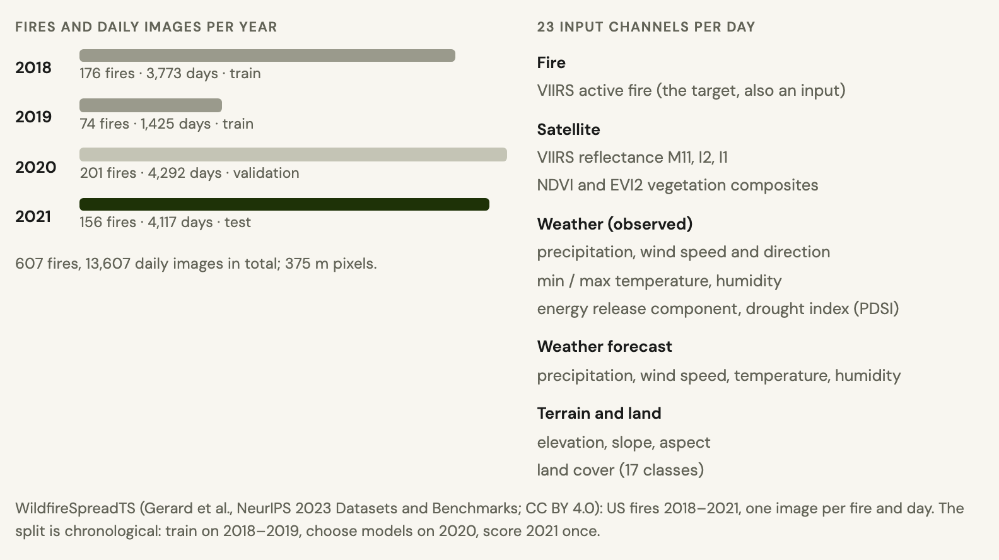</p>

The split is chronological: train on 2018–2019 (250 fires, 5,198 images), select on 2020, test on 2021. The GFS
forecast wind direction is dropped (the released data stores only its axis), and observed wind is converted to east
and north components.

## Model

A U-Net with an encoder that reads one day at a time (four residual stages, 32–128 channels, down to 1/8 resolution),
a 1 × 1 convolution that fuses the five days at each scale, and a decoder that also receives today's fire mask at full
resolution. 1.5M parameters, trained with binary cross-entropy + soft Dice on 128 × 128 crops biased towards fire.

This is a deliberately small prototype, roughly a tenth of the size of the benchmark's Res18 U-Net and close in
scale to its small UTAE. The table shows **size and design, not a leaderboard**: the papers average over held-out
years (12 folds for WSTS, four for WSTS+), while this project uses one chronological split (validation 2020,
test 2021). No AP values are compared across rows. Counts are from
[Gerard et al., Table 5](https://proceedings.neurips.cc/paper_files/paper/2023/file/ebd545176bdaa9cd5d45954947bd74b7-Paper-Datasets_and_Benchmarks.pdf)
and [Lahrichi et al., Table 2](https://arxiv.org/html/2502.12003v3#S5.T2); this project's count comes from the bundle.

<p align="center">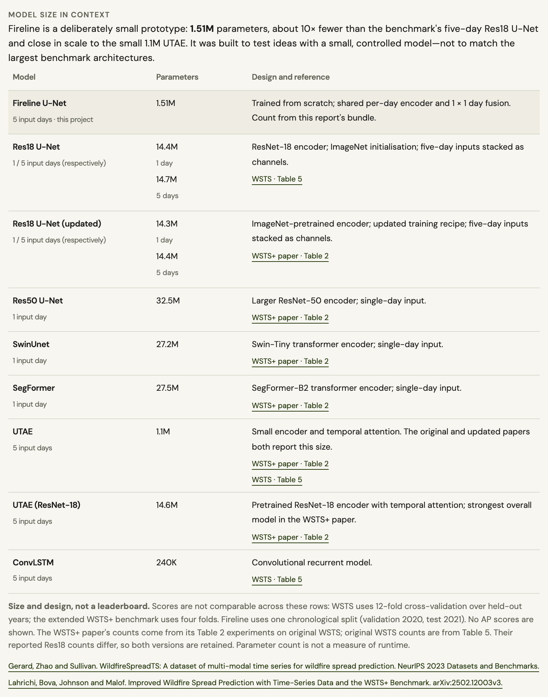</p>

Supervised training uses **one output loss**, binary cross-entropy + soft Dice with equal weights over valid
(non-padding) pixels, computed in float32 and backpropagated through the whole model. The shared encoder receives
gradients from all five days; it has no separate supervised loss. Dice is differentiable F1-style overlap: it ignores
true negatives but penalises false alarms. BCE scores probability errors; adding Dice does not guarantee calibration.
The figure below reads the saved AdamW settings, warm-up/cosine schedule, gradient clipping, batch size and epoch
count from the bundle. The checkpoint is chosen by **validation AP**, not training loss. Only the separate JEPA
pretraining phase has a representation objective; the frozen-encoder probe uses the same BCE + Dice.

<p align="center">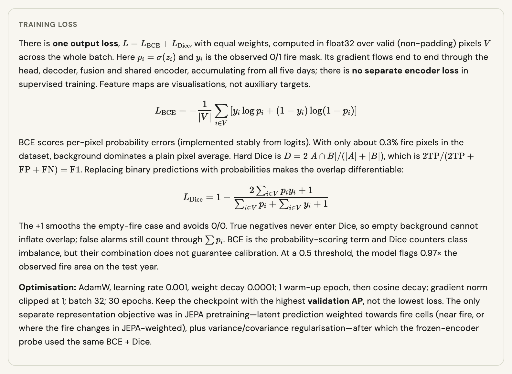</p>

Each sample has **18 daily channels over five days**, plus **21 static channels** (including 17 one-hot land-cover
classes). The shared encoder reads 18 + 21 = 39 channels per day: days are folded into the batch, not stacked into
195 input channels. The walk-through shows all daily inputs, separate static views, daily-mean wind arrows,
physical-value ranges, encoder features at all four scales, fused and decoder maps, and tensor shapes and parameter
counts from the model. Its example is the Dixie Fire on **27 August 2021 → 28 August**, with inputs from 23–27 August,
chosen by the same fixed input-coverage rule as the website report.

<p align="center">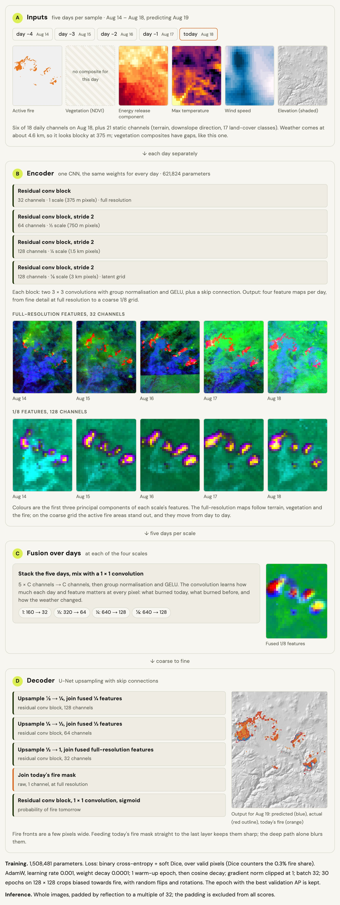</p>

The per-day encoder lets a pretrained encoder be swapped in and frozen without changing anything else (the JEPA
experiment). The direct path for today's fire mask gives the model the strong prior that most fire stays where it is.

## Results

AP summarises the precision–recall trade-off over every threshold. The example below is one test day at a threshold
of 0.5; the shaded area under the curve is that day's AP.

<p align="center">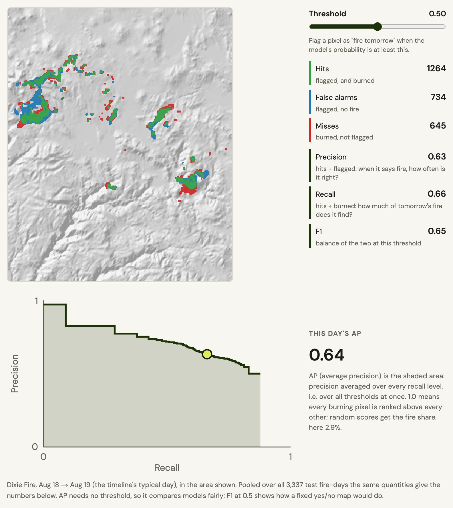</p>

<p align="center">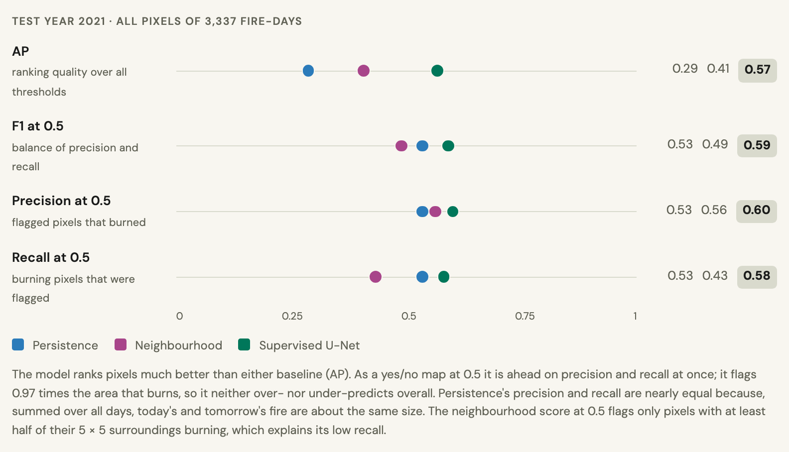</p>

The model ranks pixels much better than either baseline. As a yes/no map at 0.5 it is ahead on precision and recall
at once and flags 0.97 times the area that burns. Every method scores higher on 2021 than on 2020 (persistence 0.287
against 0.196): 2021 has less fire far from the previous day's.

## Analysis: Where Tomorrow's Fire Comes From

<p align="center">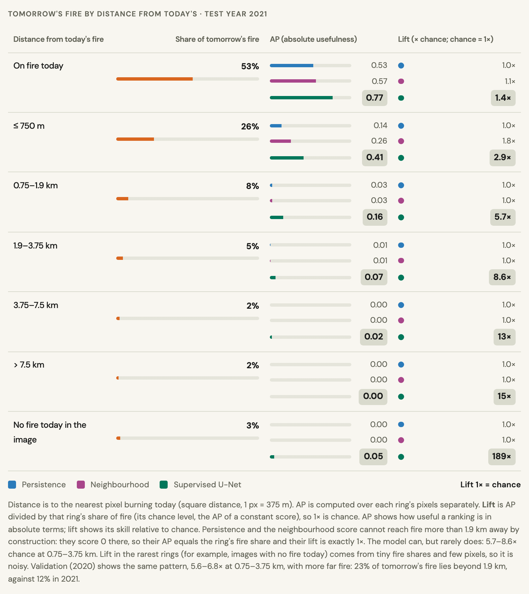</p>

Each ring further from today's fire roughly halves the model's AP, which shows absolute usefulness. **Lift** (AP
divided by the ring's fire share; 1× is chance) shows skill relative to chance: on the test year the model is
1.4× chance on pixels burning today, 2.9× within 750 m, and 5.7–8.6× at 0.75–3.75 km. The baselines cannot reach fire
more than 1.9 km away at all, so their lift there is exactly 1×; the model can, but rarely does. Lift in the rarest
rings rests on tiny fire shares and few pixels, so it is noisy.

<p align="center">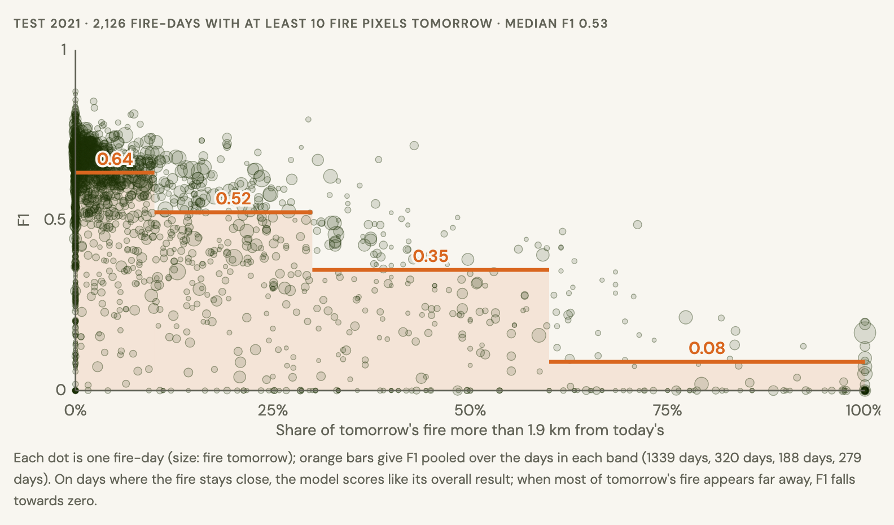</p>

On days where the fire stays close, pooled F1 is 0.64; on the 279 days where most of the next day's fire is far away,
it is 0.08.

<p align="center">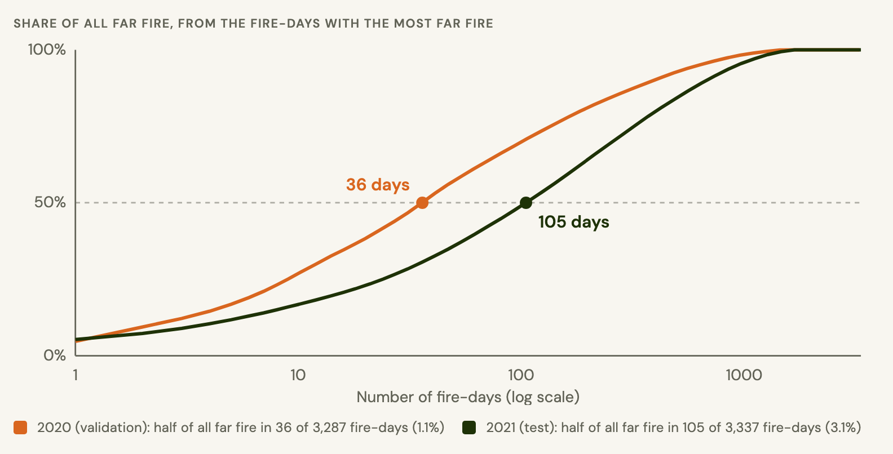</p>

<p align="center">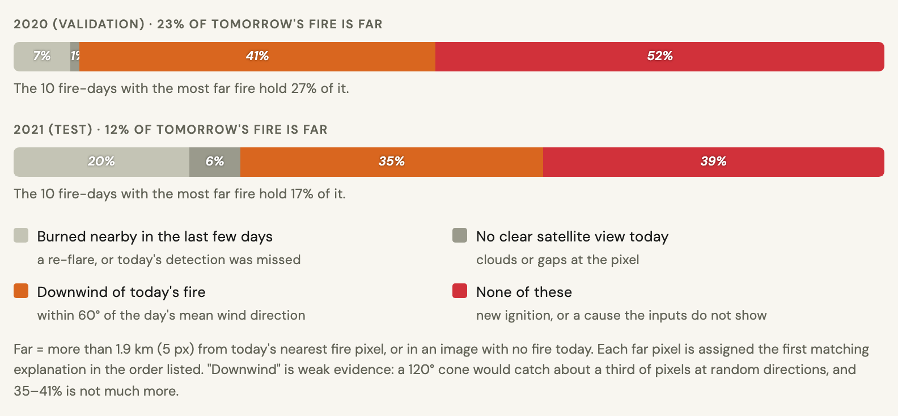</p>

Most far fire has no visible cause in the inputs. Downwind of today's fire covers 35–41%, only slightly more than a
random 120° cone would; the weather inputs are daily means at about 4.6 km. Detection gaps add to the problem:

<p align="center">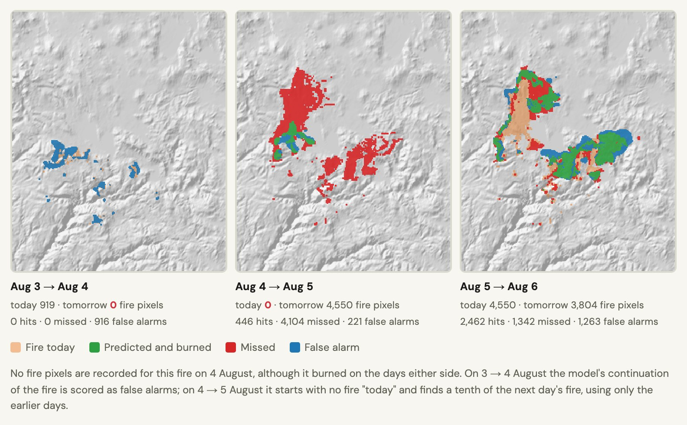</p>

## Does JEPA Pretraining Help?

Supervised training learns only from tomorrow's fire mask: 0.3% positive pixels on about 5,200 labelled fire-days.
A JEPA learns by predicting the *representation* of the next day from the previous five, with no labels, and can
ignore what is unpredictable (clouds, sensor noise) instead of reconstructing pixels.

<p align="center">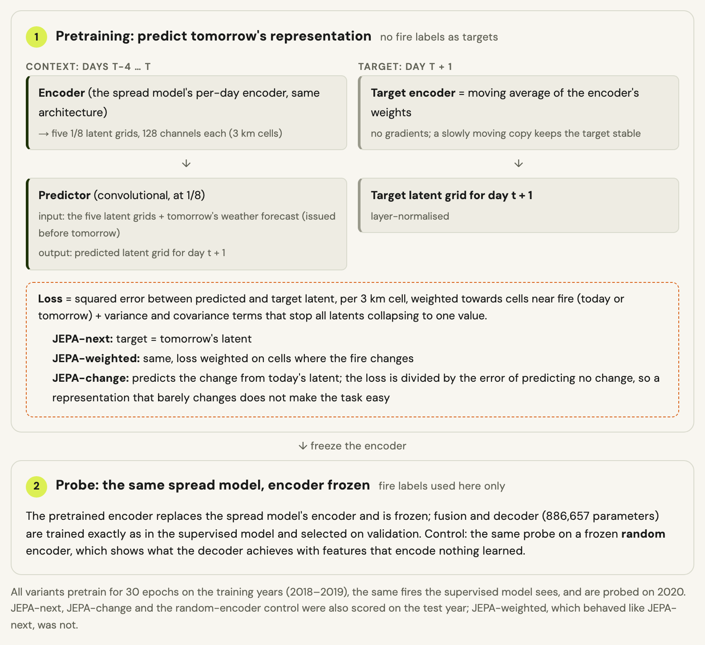</p>

Three variants were pretrained on 2018–2019: **JEPA-next** predicts tomorrow's latent map; **JEPA-change** predicts
the change from today's latent, with the loss divided by that of predicting no change. Both weight cells near fire
today or tomorrow. **JEPA-weighted** predicts tomorrow's latent map but emphasises cells where the fire changes.
All three use fire-weighted latent prediction plus variance/covariance regularisation. Viability gates were fixed
before any result: no collapse, a
predictor at least 10% better than copying today's latent near the fire, and a frozen-encoder AP within 0.03 of the
supervised model on validation (0.43 or more).

<p align="center">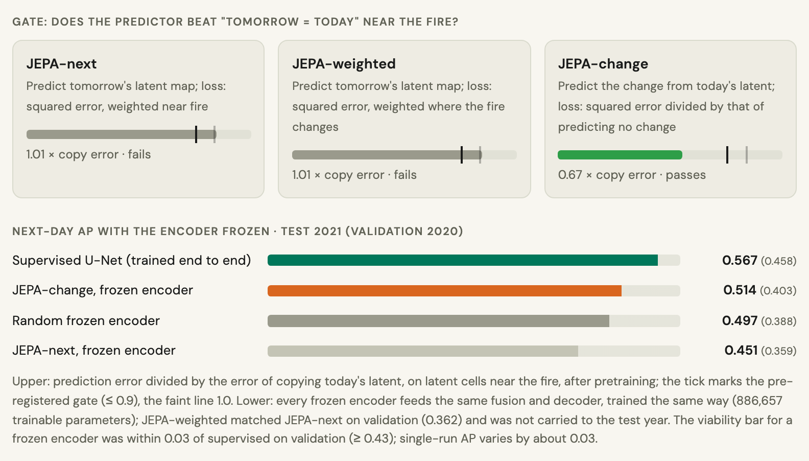</p>

<p align="center">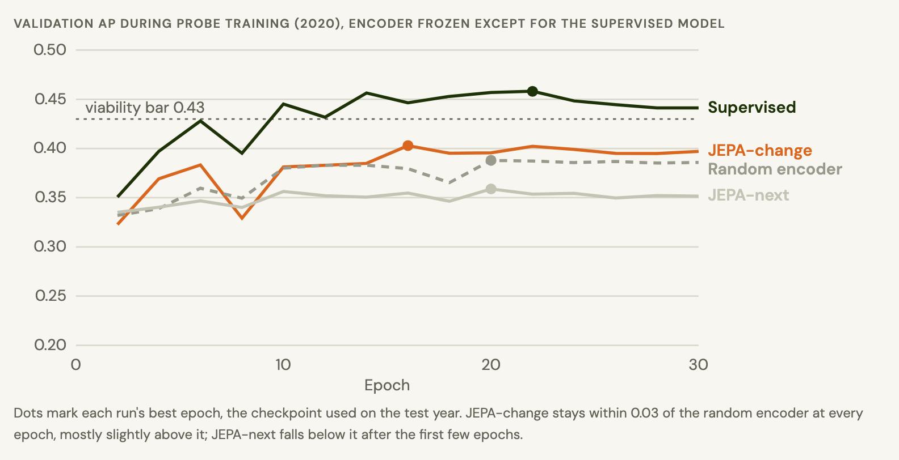</p>

JEPA-change passed the predictor gate but reached AP 0.403 on validation (0.514 on test), 0.015 (0.017) above a frozen
random encoder: within single-run noise. Verdict, by the pre-registered rule: not viable at this data scale.

<p align="center">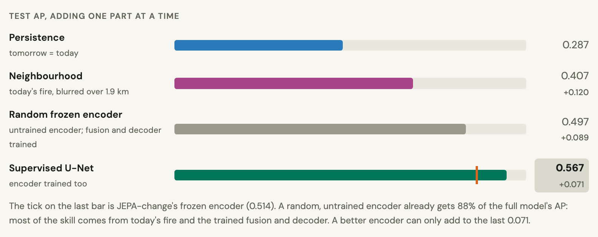</p>

Why it failed:

- **Little room for the encoder.** A random frozen encoder already reaches 88% of the full model's AP; most skill
  comes from today's fire and the trained decoder. JEPA-change recovered about a quarter of the remaining gap.
- **Copying was almost the right answer.** JEPA-next's representation barely changed between days (copy error about
  1% of the target variance): terrain, land cover and most weather are the same tomorrow.
- **No extra data.** Pretraining used the same 2018–2019 fires as supervised training. JEPA is most promising with far
  more unlabelled data (every day, with or without fire), few labels, or sub-daily inputs.

## A Leak in the Benchmark

<p align="center">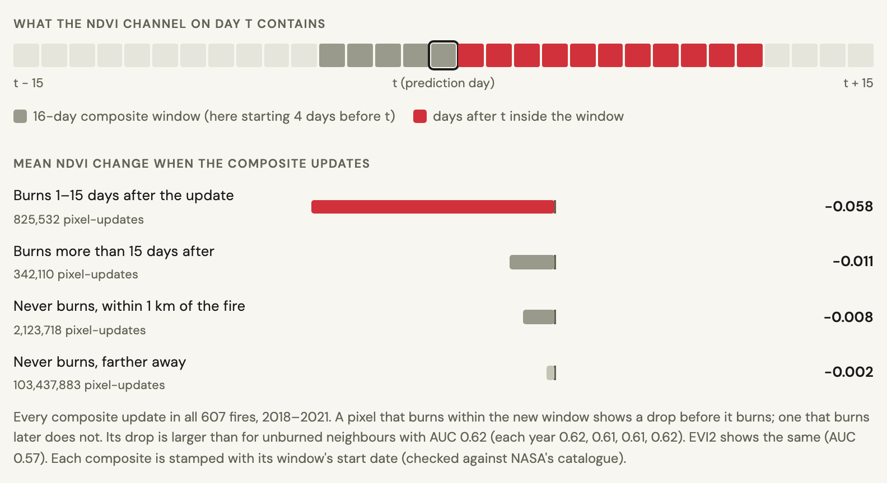</p>

NDVI and EVI2 are 16-day composites, updated every 8 days. The value on day t comes from the latest composite whose
window started within the previous 15 days, so the window reaches 8–15 days past t. Pixels that burn inside it
already lose NDVI at the update: AUC 0.62 against unburned neighbours (0.61–0.63 every year; EVI2 0.57).

<p align="center">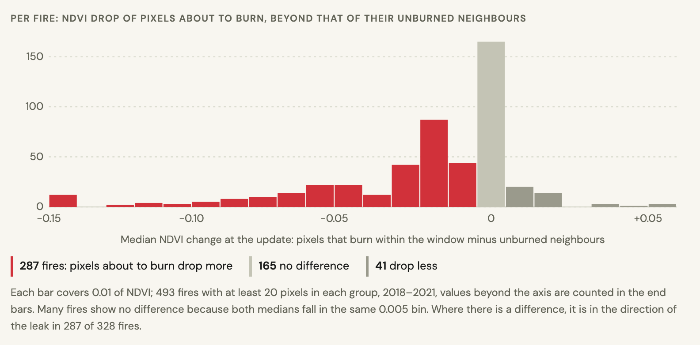</p>

Results here use the channels as published, for comparability with other work on the benchmark. A deployed model
would need composites that end before the prediction day.

## What Didn't Help

Five extra channels per day (distance to today's fire, the fire mask shifted 0.75, 1.5 and 3 km downwind, and how far
the wind blows uphill) were pre-registered to raise AP by 20% at 0.75–3.75 km. They did not, in either year, and made
training converge faster without changing where it ends.

<p align="center">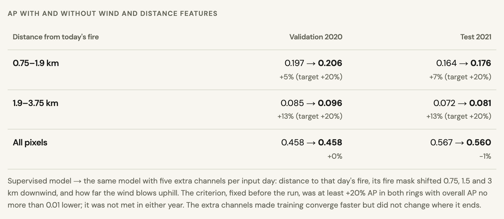</p>

## Limitations and Next Steps

- **One fire map per day.** Runs that start and end between satellite passes are invisible; gaps (the Dixie Fire on
  4 August) are scored as if the fire stopped.
- **Daily weather at about 4.6 km.** The afternoon wind shift or gust that drives a run is averaged away.
- **No ignition sources.** Lightning, embers and people are not inputs; 39% of far fire in 2021 (52% in 2020) has no
  visible cause.
- **Vegetation from the future, or missing.** See the leak above; some days have no composite.
- **Noisy labels.** Detections, not burned area: low-intensity fire is missed and the same ground can flare again.
- **Few fires, most arms have one run.** The supervised-baseline seed check below does not establish JEPA's
  run-to-run variance; small representation gains still need several seeds per arm.
- **Probability calibration is unchecked.** The model ranks much better by AP, but its test-year Brier score is
  slightly worse than the neighbourhood baseline's (the ordering reverses on validation). Overconfidence is
  plausible, not established: no reliability diagram or calibration-error check was made, and Brier alone cannot
  diagnose calibration. The table below reads the saved results; its constant-fire-share row is a hindsight reference.

- **Larger model and temporal attention.** Try a U-Net with a pretrained ResNet-18 encoder and content-dependent
  day weighting instead of fixed 1 × 1 fusion. The [WSTS+ paper](https://arxiv.org/html/2502.12003v3#S5.T2) found
  modest gains over five-day stacking on original WSTS, not a guarantee of gains here; larger models alone did
  not improve consistently. Judge each change with several validation seeds and confirm on a new held-out season.
  Far fire remains limited by the inputs.

- **Check and calibrate probabilities.** Measure reliability and expected calibration error on validation, overall
  and by distance ring, then fit positive-temperature scaling, positive-slope Platt scaling or isotonic regression
  on 2020. Strictly increasing transforms preserve AP and precision–recall curves; isotonic can introduce ties and
  change AP. Reuse saved validation predictions where available, or make one validation-only prediction pass—no
  network retraining. Check transfer on a fresh held-out season; seasonal updates need a separate labelled calibration
  period, never the test labels. These remain next-day active-fire-detection probabilities, not burned-area estimates.

<p align="center">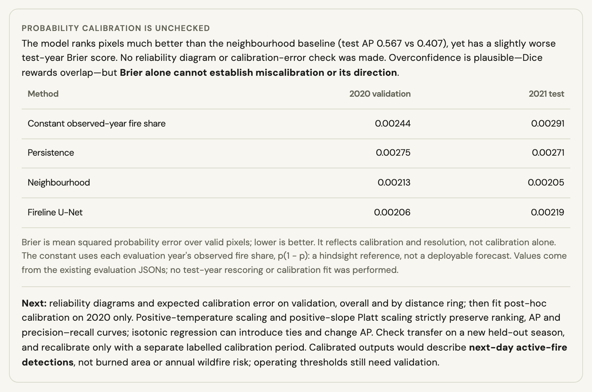</p>

<p align="center">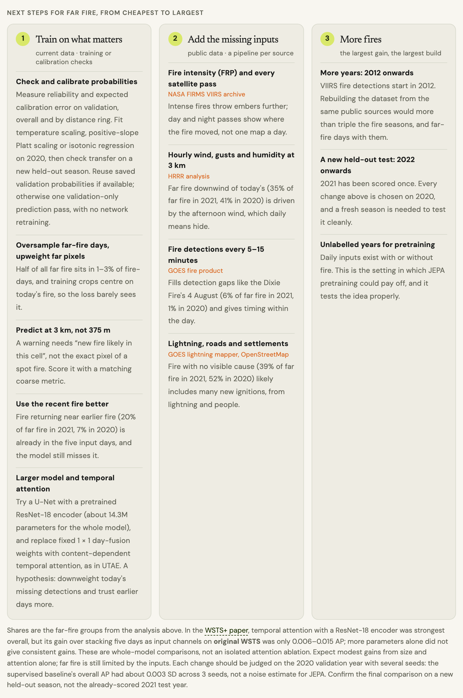</p>

## Repository Layout

```
src/fireline/
  data/       WildfireSpreadTS download and conversion (per-fire .npz), validation, features, samples, caching
  models/     spread model (per-day encoder, fusion, decoder) and the JEPA (predictor, EMA target, losses)
  train/      supervised, JEPA pretraining and frozen-encoder probe training
  baselines/  persistence and neighbourhood baselines, normalisation statistics
  eval/       AP/F1/IoU, distance-ring evaluation, full-image inference per fire
  analysis/   far-fire attribution, composite-leak analysis
modal_app.py  runs every stage on Modal (CPU for data and analyses, L4/A10 GPU for training and evaluation)
report/       report pipeline: scripts, figure capture and the generated bundle (numbers + imagery)
assets/       README figures, captured from the website report (drawn from report/bundle)
tests/        CPU unit tests on synthetic data
```

## Setup

Requires Python 3.14 and [uv](https://docs.astral.sh/uv/).

```bash
uv sync --group dev                         # add --group cloud for Modal, --group notebook for the report
```

**Data.** WildfireSpreadTS (CC BY 4.0) is not included. The ingest streams fires straight from the Zenodo archive and
converts each to one `.npz` file:

```bash
uv run python -m fireline.data.ingest --year 2019 --list
uv run python -m fireline.data.ingest --year 2019 --all --workers 8 --out datasets/processed/wsts
```

## Reproduce

Every stage runs on Modal in its own environment (`fireline`) with a hard time budget; see the docstring of
`modal_app.py`. Without `--confirm-run` an entrypoint only prints its plan. Runs never overwrite earlier outputs.

```bash
M="modal run -e fireline --detach modal_app.py"
$M::ingest_full --run-name ingest-wsts-01 --confirm-run                  # convert and validate all four years
$M::baselines --run-name baselines-01 --confirm-run                      # statistics and baselines (2020)
$M::train_supervised --run-name unet-sup-02 --epochs 30 --val-every 2 --confirm-run   # the model
$M::far_fire --run-name far-fire-01 --confirm-run                        # distance rings, far-fire attribution
$M::composite_leak --run-name leak-wsts-01 --confirm-run                 # vegetation-composite leak
$M::train_jepa --run-name jepa-01 --confirm-run                          # JEPA-next: pretraining + probe
$M::train_jepa --run-name jepa-02a --weighting change --confirm-run      # JEPA-weighted
$M::train_jepa --run-name jepa-02b --target-mode change --confirm-run    # JEPA-change pretraining
$M::train_probe --run-name jepa-02b-probe-r2 --encoder-run jepa-02b-pretrain --confirm-run   # its probe
# control: the same probe on a random, untrained frozen encoder
$M::train_supervised --run-name probe-random-03 --epochs 30 --val-every 2 --random-frozen-encoder --confirm-run
$M::train_wind --run-name unet-wind-01 --confirm-run                     # wind features
$M::test_year --run-name test-2021-01 --confirm-run                      # test year, once, after all choices
```

**Report.** The website report and this README are built from one committed bundle, `report/bundle/`; see
[report/README.md](report/README.md).

## Tests

```bash
uv run pytest
uv run ruff check .
```

## License

Code: MIT ([LICENSE](LICENSE)). Imagery and numbers derived from WildfireSpreadTS are under CC BY 4.0
([LICENSES/WildfireSpreadTS-CC-BY-4.0.md](LICENSES/WildfireSpreadTS-CC-BY-4.0.md)).
